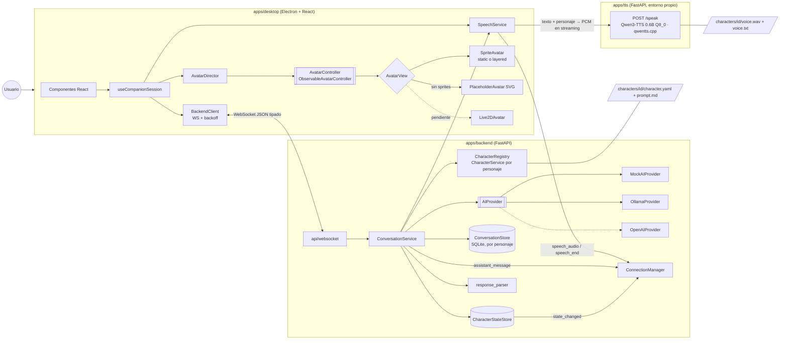

# Arquitectura

Estado: **Fase 2 en curso (avatar de sprites y varios personajes listos; Live2D pendiente)**. Este documento se actualiza cuando cambia la
arquitectura de forma significativa.

## Vista general



Las líneas punteadas son implementaciones planificadas (stubs o fases futuras).

## Flujo de un turno

```mermaid
sequenceDiagram
    participant UI as React
    participant WS as WebSocket
    participant Conv as ConversationService
    participant AI as AIProvider
    participant State as CharacterStateStore

    UI->>WS: user_message {text}
    WS->>Conv: handle_user_message
    Conv->>State: THINKING
    State-->>UI: state_changed thinking
    Conv->>AI: chat(ChatContext)
    AI-->>Conv: texto crudo (JSON esperado)
    Conv->>Conv: parse_assistant_reply → AssistantReply validado
    Conv-->>UI: assistant_message {text, emotion, gesture...}
    Conv->>State: SPEAKING
    State-->>UI: state_changed speaking
    UI->>UI: AvatarDirector → expresión/gesto; SpeechOutput "habla"
    UI->>WS: speech_finished
    WS->>Conv: finish_speaking
    Conv->>State: IDLE
    State-->>UI: state_changed idle
```

Si el proveedor falla o excede `AI_TIMEOUT_SECONDS`: `THINKING → ERROR`, se envía
`error {code, message}` y la UI muestra "AI connection error". El siguiente mensaje del
usuario sale de `ERROR` directamente a `THINKING`.

## Decisiones clave

| Decisión | Motivo |
|---|---|
| **El backend es dueño del estado** (`CharacterStateStore`) | Única fuente de verdad. La UI solo refleja `state_changed`; la conexión (`offline`) es lo único que decide el frontend. |
| **Máquina de estados con transiciones permitidas** | Evita combinaciones de booleanos imposibles (`thinking && speaking`). Ver `ALLOWED_TRANSITIONS` en `app/character/state.py`. |
| **`speech_finished` lo envía el cliente** | Solo el cliente sabe cuándo terminó de reproducir. Hoy es una estimación por longitud de texto; en Fase 3 será el fin real del audio TTS. Mismo protocolo. |
| **El esquema de respuesta viaja en `ChatContext.response_schema`** | Los proveedores con salida estructurada (Ollama `format`, OpenAI `response_format`) lo aplican; el parser sigue validando por si acaso. |
| **El historial guarda la respuesta del asistente como JSON completo** | Los modelos imitan el historial. Con turnos previos en texto plano, gpt-oss devolvía respuestas vacías bajo un esquema JSON (2/5 correctas); con JSON, 5/5. |
| **Hooks opcionales `warm_up()` / `aclose()` en `AIProvider`** | Precargar el modelo al iniciar (en segundo plano, sin bloquear el arranque) y cerrar clientes HTTP al apagar. |
| **El proveedor devuelve texto crudo; el parser valida** | Toda salida del modelo pasa por la misma validación campo a campo con valores seguros por defecto, sin importar el proveedor. |
| **Fixtures de protocolo compartidas** (`shared/protocol-fixtures`) | Los tipos TS y Pydantic están duplicados a mano; ambos test suites validan los mismos JSON, así que cualquier divergencia rompe un test. Se evitó generar código para no añadir tooling en el MVP. |
| **`AvatarController` + `AvatarDirector`** | El director traduce eventos del agente a comandos semánticos; el controller los traduce al motor gráfico. Live2D/VRM solo implementan `AvatarController`. |
| **Estado del avatar separado de la vista** (`ObservableAvatarController`) | Un único estado observable (expresión, gesto, parpadeo, boca); cada renderer (sprites, SVG) solo decide cómo dibujarlo. |
| **Sprites por capas (cuerpo + ojos + boca)** | Con imágenes alineadas, ojos y boca de imágenes distintas se combinan (p. ej. ojos tristes + boca abierta al hablar). Las capas tienen bordes difuminados que solapan en la nariz. |
| **Assets de sprites empaquetados por Vite** (`import.meta.glob`) | Funcionan igual en desarrollo y en el build (sin `fetch` de `file://`). Si la carpeta está vacía, se usa el placeholder. |
| **Preparación de assets offline** (`tools/avatar/`) | Quitar el fondo requiere un modelo de ML (rembg); se hace una vez al generar, no en la app. La herramienta valida que las imágenes estén alineadas. |
| **Un personaje por carpeta** (`characters/<id>/`) | Personalidad, prompt y avatar viajan juntos; añadir un personaje es crear una carpeta. El `id` es el nombre de la carpeta y también el del set de sprites, así el frontend no necesita otra tabla. |
| **Una conversación por personaje** | Con el historial de otro, el nuevo personaje respondería como el viejo (los modelos imitan el historial). Cada personaje lee y escribe solo la suya; `character_changed` y `session_ready` llevan su `history` para que el cliente la muestre. Cambiar se rechaza (`busy`) mientras hay un turno en curso. |
| **`prompt.md` + contexto de la app al final** | Las personalidades escritas a mano mencionan cámara, micrófono y acciones entre asteriscos. Una sección final "CURRENT APP CONTEXT" dice qué existe hoy, sin editar el texto del personaje. |
| **`OLLAMA_NUM_CTX=16384`** | Los prompts de personalidad ocupan ~5k tokens; con la ventana por defecto de Ollama, el inicio de la conversación se cortaría sin avisar. Se envía igual en la precarga y en cada mensaje, para que Ollama no recargue el modelo. |
| **Sprites static y layered** | Un personaje puede tener una sola imagen mientras se generan sus variantes de cara; pasar a layered es solo regenerar assets. |
| **Composition root** (`app/container.py`) | Único lugar donde se instancian servicios concretos; facilita tests y cambiar implementaciones. |
| **Turnos como tareas asyncio** | El socket sigue leyendo mientras la IA piensa (permite responder `busy` y, a futuro, interrupciones). |
| **Memoria a largo plazo por consolidación** | `MemoryConsolidator` (`app/memory/long_term.py`) pide al mismo modelo, con esquema JSON, una lista de hechos sobre el usuario y un resumen, fusionando la memoria anterior con los mensajes que están por salir de la ventana (se consolidan *antes* de salir, así nada queda en un hueco). Corre como tarea en segundo plano tras el turno; si falla solo se registra. Se guarda en la tabla `long_term_memory` con `covered_until` (último id consolidado) y va al final del prompt de sistema para no romper la caché del prefijo. Una respuesta con `facts: []` no borra la memoria. Olvidar la conversación invalida una consolidación en curso (contador de generación). Sin embeddings: con decenas de hechos no hace falta búsqueda. |
| **Recordatorio de personaje dentro del último mensaje** | El prompt de personalidad (~4.700 tokens) queda lejos de la respuesta y gpt-oss acababa sonando a asistente genérico y muy breve. `CharacterService.build_reminder()` se añade entre corchetes al final del último mensaje del usuario en cada turno (no se guarda). No va como mensaje `system`: las plantillas de Ollama mueven los `system` al inicio (gpt-oss, qwen3) o, en mistral-nemo, los descartan si el último mensaje no es del usuario — con eso mistral-nemo perdía la personalidad entera. Con él las respuestas pasaron de 9–25 a 35–65 palabras sin coste de latencia. Longitud configurable con `reply_length`. |
| **Voz en un servicio aparte (`apps/tts`)** | Necesita una librería nativa con CUDA (qwentts.cpp) que no pinta nada en el entorno del backend, y la generación vive en un único hilo, una petición a la vez. El backend lo consume por HTTP local (`/speak` devuelve PCM en streaming) y reenvía el audio por el WebSocket como `speech_audio`: React nunca habla con servicios de IA. Escucha en `127.0.0.1:8010` (el 8001 suele estar ocupado). |
| **Qwen3-TTS: diseñar una vez, clonar siempre** | VoiceDesign (1.7B) inventa la voz desde una descripción en cada llamada, así que podría variar entre frases. Se diseña una muestra por personaje (`make voice`) y en tiempo real el modelo Base 0.6B la clona: voz constante. Las referencias (embedding de voz + códigos del códec) de todos los personajes se extraen al arrancar y se reutilizan, así que cada frase empieza a sonar en ~0,15 s. |
| **qwentts.cpp a 8 bits en vez de PyTorch** | Comparado en la misma GPU: Q8_0 suena igual que BF16, usa ~0,4–0,8 GB menos, va a 6–8× tiempo real (PyTorch con CUDA graphs: ~3×, y bajaba a ~1,5× con la GPU casi llena, cortando el audio) y no necesita PyTorch (entorno de 300 MB en vez de 6,3 GB). El paquete no está en PyPI para Linux: `make setup-tts` lo instala desde el índice de wheels de faster-qwen3-tts (build CUDA 12.8). La ruta oficial `qwen-tts` era más lenta que tiempo real. |
| **La voz nunca bloquea el turno** | El texto se entrega primero; el audio se genera en segundo plano. Un mensaje nuevo del usuario, un cambio de personaje u «Olvidar» cancelan el audio en curso, y siempre se envía `speech_end` para que el cliente no espere para siempre. El cliente envía `speech_finished` al terminar de reproducir el audio real. |
| **El historial se ajusta al contexto** | Con `num_ctx` 8k (para dejar VRAM a la voz) el historial podía desbordar y Ollama recortaría el *inicio* del prompt: la personalidad. `ConversationService` estima tokens (3 caracteres por token, conservador) y descarta los mensajes más antiguos que no quepan, dejando 600 tokens para la respuesta. |
| **Modelo global, solo local, elegido en la app** | `select_model` solo acepta modelos de `/api/tags` con capacidad `completion` (y un patrón de nombre). Al cambiar: espera la consolidación de memoria en curso, descarga el modelo anterior (`keep_alive: 0`, dos no caben en 16 GB), precarga el nuevo y bloquea turnos (`busy`) mientras carga. La elección se guarda en `app_state.ai_model` y se restaura al arrancar si sigue instalado. `think` se envía solo a modelos con capacidad `thinking`, y los niveles (`low`…) solo a gpt-oss: qwen3 los trata como razonamiento completo (53 s frente a 0,7 s). Ajustes de muestreo por familia (`FAMILY_OPTIONS`): qwen3 lleva `presence_penalty: 1.0` porque copiaba frases de sus propias respuestas en bucle (muletillas en 8/12 respuestas → 3/12 al reproducir una conversación real). |
| **Historial en SQLite** | `SqliteConversationStore` (`data/memory.sqlite3`) guarda todos los mensajes por personaje y el último personaje activo; al modelo solo van los últimos `SHORT_TERM_MEMORY_SIZE`. Las respuestas se guardan como el JSON completo (el historial en texto plano hacía que gpt-oss respondiera vacío). Sin hilos: las consultas son mínimas y locales. Memoria a largo plazo y Postgres/pgvector siguen pendientes (Fase 5). |
| **Sin `docker-compose` aún** | No hay servicios externos que orquestar hasta Fase 5 (Postgres/pgvector). |

## Protocolo WebSocket (v5)

Definido en `apps/backend/app/models/protocol.py` y `apps/desktop/src/renderer/src/protocol/types.ts`.

**Cliente → servidor**

| type | campos | |
|---|---|---|
| `user_message` | `text` (1–4000) | Mensaje de chat. |
| `speech_finished` | — | El cliente terminó de presentar la respuesta. |
| `select_character` | `character_id` (`^[a-z0-9][a-z0-9_-]{0,63}$`) | Cambia de personaje y retoma su conversación. |
| `set_voice` | `enabled` (booleano estricto) | Activa o desactiva la voz; se recuerda. |
| `select_model` | `model` (instalado en Ollama) | Cambia el modelo para todos los personajes; se recuerda. `busy` si hay un turno o una carga en curso. |
| `clear_conversation` | — | Olvida la conversación y la memoria a largo plazo del personaje activo (también en disco). `busy` si hay un turno en curso. |

**Servidor → cliente**

| type | campos |
|---|---|
| `session_ready` | `protocol_version`, `character_id`, `character_name`, `characters` (`[{id, name}]`), `history`, `ai_provider`, `ai_is_remote`, `ai_model`, `ai_models`, `ai_model_loading`, `voice_available`, `voice_enabled`, `privacy`, `state` |
| `character_changed` | `character_id`, `character_name`, `history` (a todos los clientes) |
| `conversation_cleared` | `character_id` (a todos los clientes; vacían el chat) |
| `model_changed` | `model`, `loading` (primero `true` mientras carga, luego `false`) |
| `state_changed` | `state`: `idle \| listening \| thinking \| speaking \| error` |
| `assistant_message` | `text`, `emotion`, `emotion_intensity` (0–1), `gesture`, `look_at_user`, `utterance_id`, `voice` (si `true`, siguen `speech_audio` y `speech_end`) |
| `speech_audio` | `utterance_id`, `seq`, `sample_rate`, `pcm` (base64, PCM 16 bits LE mono) |
| `speech_end` | `utterance_id`, `ok` (`false`: falló o se interrumpió) |
| `voice_changed` | `available` (servicio listo y el personaje tiene voz), `enabled` |
| `error` | `code`: `ai_provider_error \| ai_timeout \| invalid_message \| busy \| unknown_character \| unknown_model \| internal_error`, `message` |

`history` es una lista de `{role: user|assistant, text, emotion?, gesture?}` (los últimos 100 mensajes del personaje).

Mensajes que no cumplen el esquema se rechazan en ambos extremos (el backend responde
`invalid_message`; el frontend los ignora). No existe ningún mensaje que ejecute comandos.

## Seguridad y privacidad

- Electron: `contextIsolation`, `sandbox`, sin `nodeIntegration`, CSP estricta, navegación
  bloqueada y **todas las solicitudes de permisos (cámara/micrófono) denegadas** hasta que
  existan esas funciones y el usuario las active.
- El renderer solo ve variables `VITE_*`; las API keys viven en `.env` y solo las lee
  `Settings` del backend (`SecretStr`, nunca se imprimen).
- La barra de estado muestra si el proveedor de IA es remoto y el estado de Mic/Cámara.

## Puntos de extensión por fase

| Fase | Dónde se conecta |
|---|---|
| 2 Live2D | Nueva vista en `src/renderer/src/avatar/live2d/` que lea `ObservableAvatarController` + tabla emoción→expresión por modelo; se elige en `AvatarView`. `AvatarDirector` no cambia. |
| 3 Audio | Voz hecha: `SpeechService` (backend) ↔ `apps/tts`; `AudioSpeechPlayer` (frontend) reproduce y mueve la boca con `setMouthOpen`. Falta: Captura de mic + VAD; fase `listening` ya existe en la máquina de estados. |
| 4 Cámara | `analyze_image` ya está en `AIProvider`. Nuevo `VisionService` en backend. |
| 5 Memoria | Historial por personaje y memoria a largo plazo (hechos + resumen) hechos; faltan embeddings/recuperación semántica si la memoria crece mucho. |
| 6 Eventos | `EventBus` + `BehaviorService`; `CharacterState` ya tiene `is_user_present` y `last_interaction_at`. |
