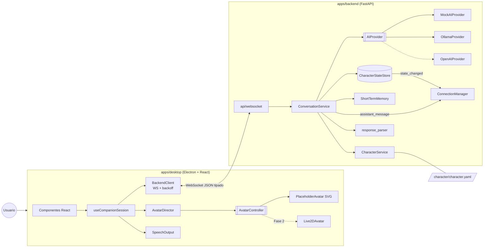

# Arquitectura

Estado: **Fase 1 (MVP de chat de texto, con IA local vía Ollama)**. Este documento se actualiza cuando cambia la
arquitectura de forma significativa.

## Vista general



Las líneas punteadas son implementaciones planificadas (stubs o fases futuras).

## Flujo de un turno

```mermaid
sequenceDiagram
    participant UI as React
    participant WS as WebSocket
    participant Conv as ConversationService
    participant AI as AIProvider
    participant State as CharacterStateStore

    UI->>WS: user_message {text}
    WS->>Conv: handle_user_message
    Conv->>State: THINKING
    State-->>UI: state_changed thinking
    Conv->>AI: chat(ChatContext)
    AI-->>Conv: texto crudo (JSON esperado)
    Conv->>Conv: parse_assistant_reply → AssistantReply validado
    Conv-->>UI: assistant_message {text, emotion, gesture...}
    Conv->>State: SPEAKING
    State-->>UI: state_changed speaking
    UI->>UI: AvatarDirector → expresión/gesto; SpeechOutput "habla"
    UI->>WS: speech_finished
    WS->>Conv: finish_speaking
    Conv->>State: IDLE
    State-->>UI: state_changed idle
```

Si el proveedor falla o excede `AI_TIMEOUT_SECONDS`: `THINKING → ERROR`, se envía
`error {code, message}` y la UI muestra "AI connection error". El siguiente mensaje del
usuario sale de `ERROR` directamente a `THINKING`.

## Decisiones clave

| Decisión | Motivo |
|---|---|
| **El backend es dueño del estado** (`CharacterStateStore`) | Única fuente de verdad. La UI solo refleja `state_changed`; la conexión (`offline`) es lo único que decide el frontend. |
| **Máquina de estados con transiciones permitidas** | Evita combinaciones de booleanos imposibles (`thinking && speaking`). Ver `ALLOWED_TRANSITIONS` en `app/character/state.py`. |
| **`speech_finished` lo envía el cliente** | Solo el cliente sabe cuándo terminó de reproducir. Hoy es una estimación por longitud de texto; en Fase 3 será el fin real del audio TTS. Mismo protocolo. |
| **El esquema de respuesta viaja en `ChatContext.response_schema`** | Los proveedores con salida estructurada (Ollama `format`, OpenAI `response_format`) lo aplican; el parser sigue validando por si acaso. |
| **El historial guarda la respuesta del asistente como JSON completo** | Los modelos imitan el historial. Con turnos previos en texto plano, gpt-oss devolvía respuestas vacías bajo un esquema JSON (2/5 correctas); con JSON, 5/5. |
| **Hooks opcionales `warm_up()` / `aclose()` en `AIProvider`** | Precargar el modelo al iniciar (en segundo plano, sin bloquear el arranque) y cerrar clientes HTTP al apagar. |
| **El proveedor devuelve texto crudo; el parser valida** | Toda salida del modelo pasa por la misma validación campo a campo con valores seguros por defecto, sin importar el proveedor. |
| **Fixtures de protocolo compartidas** (`shared/protocol-fixtures`) | Los tipos TS y Pydantic están duplicados a mano; ambos test suites validan los mismos JSON, así que cualquier divergencia rompe un test. Se evitó generar código para no añadir tooling en el MVP. |
| **`AvatarController` + `AvatarDirector`** | El director traduce eventos del agente a comandos semánticos; el controller los traduce al motor gráfico. Live2D/VRM solo implementan `AvatarController`. |
| **Composition root** (`app/container.py`) | Único lugar donde se instancian servicios concretos; facilita tests y cambiar implementaciones. |
| **Turnos como tareas asyncio** | El socket sigue leyendo mientras la IA piensa (permite responder `busy` y, a futuro, interrupciones). |
| **SQLite/Postgres todavía no** | Fase 1 solo usa memoria de corto plazo en RAM; la capa `MemoryRepository` llega en Fase 5. |
| **Sin `docker-compose` aún** | No hay servicios externos que orquestar hasta Fase 5 (Postgres/pgvector). |

## Protocolo WebSocket (v1)

Definido en `apps/backend/app/models/protocol.py` y `apps/desktop/src/renderer/src/protocol/types.ts`.

**Cliente → servidor**

| type | campos | |
|---|---|---|
| `user_message` | `text` (1–4000) | Mensaje de chat. |
| `speech_finished` | — | El cliente terminó de presentar la respuesta. |

**Servidor → cliente**

| type | campos |
|---|---|
| `session_ready` | `protocol_version`, `character_name`, `ai_provider`, `ai_is_remote`, `privacy`, `state` |
| `state_changed` | `state`: `idle \| listening \| thinking \| speaking \| error` |
| `assistant_message` | `text`, `emotion`, `emotion_intensity` (0–1), `gesture`, `look_at_user` |
| `error` | `code`: `ai_provider_error \| ai_timeout \| invalid_message \| busy \| internal_error`, `message` |

Mensajes que no cumplen el esquema se rechazan en ambos extremos (el backend responde
`invalid_message`; el frontend los ignora). No existe ningún mensaje que ejecute comandos.

## Seguridad y privacidad

- Electron: `contextIsolation`, `sandbox`, sin `nodeIntegration`, CSP estricta, navegación
  bloqueada y **todas las solicitudes de permisos (cámara/micrófono) denegadas** hasta que
  existan esas funciones y el usuario las active.
- El renderer solo ve variables `VITE_*`; las API keys viven en `.env` y solo las lee
  `Settings` del backend (`SecretStr`, nunca se imprimen).
- La barra de estado muestra si el proveedor de IA es remoto y el estado de Mic/Cámara.

## Puntos de extensión por fase

| Fase | Dónde se conecta |
|---|---|
| 2 Live2D | Nueva implementación de `AvatarController` en `src/renderer/src/avatar/live2d/` + tabla emoción→expresión por modelo. `AvatarDirector` no cambia. |
| 3 Audio | `SpeechOutput` con TTS + `LipSyncController` → `setMouthOpen`. Captura de mic + VAD; fase `listening` ya existe en la máquina de estados. |
| 4 Cámara | `analyze_image` ya está en `AIProvider`. Nuevo `VisionService` en backend. |
| 5 Memoria | `MemoryService` + `MemoryRepository` sustituyen/extienden `ShortTermMemory`. |
| 6 Eventos | `EventBus` + `BehaviorService`; `CharacterState` ya tiene `is_user_present` y `last_interaction_at`. |
